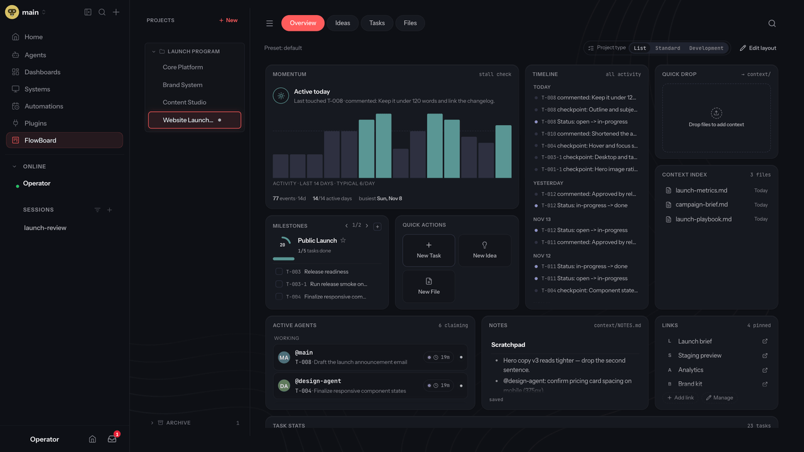
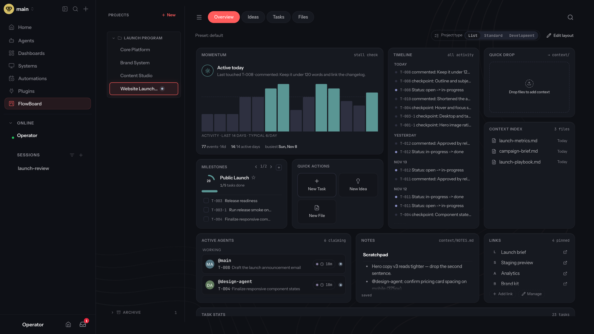
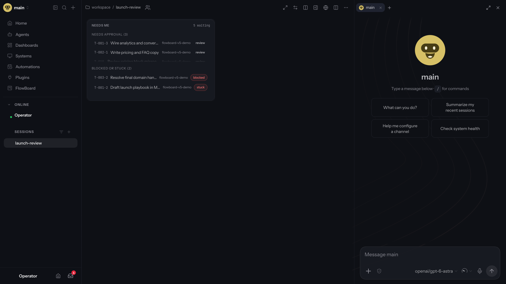
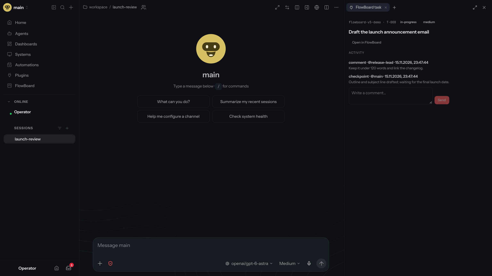
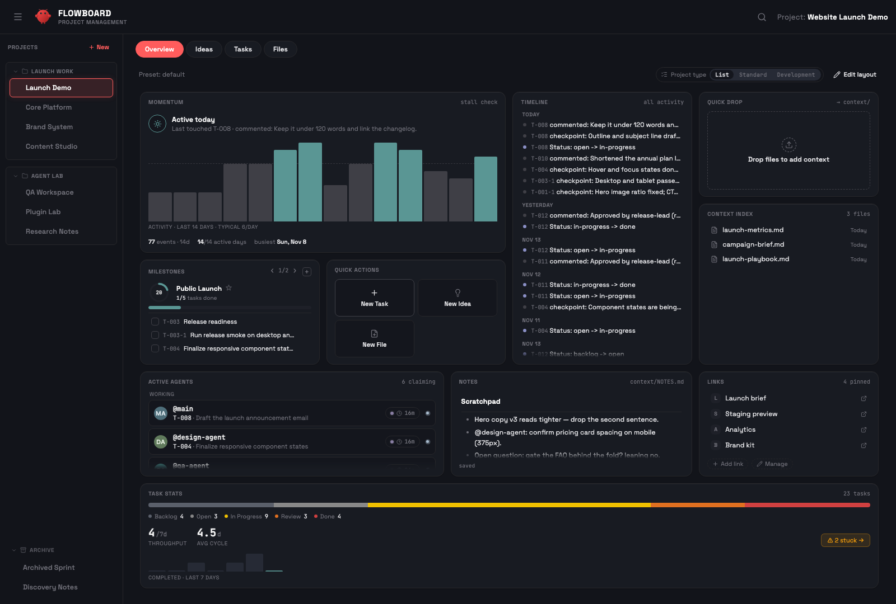
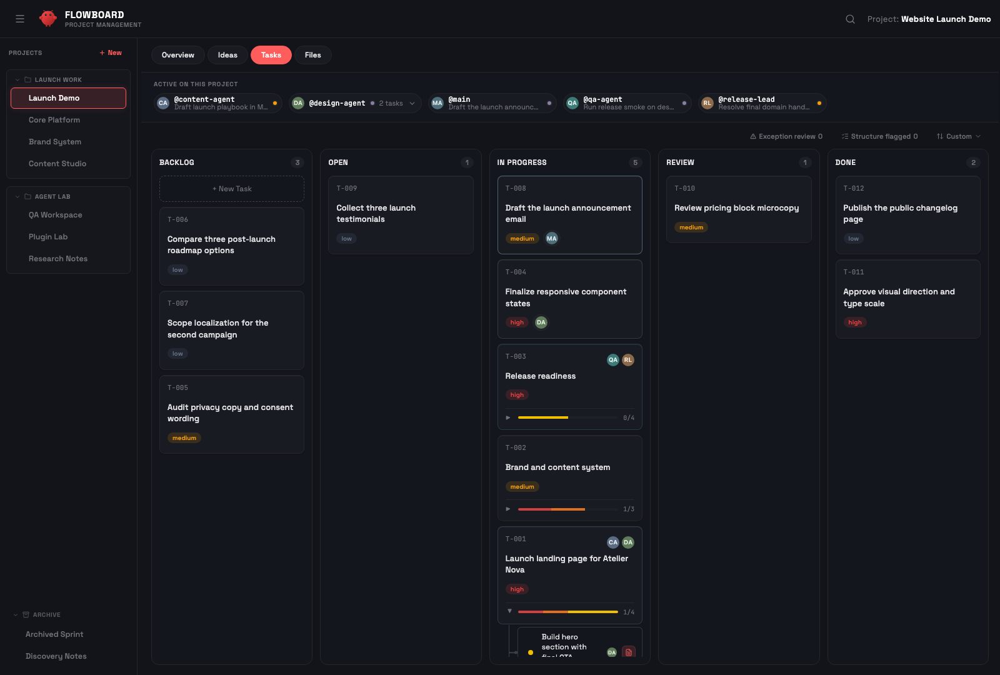
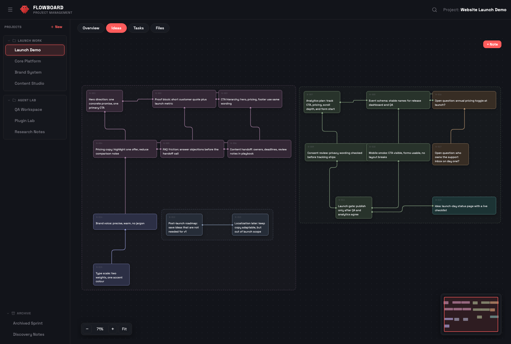
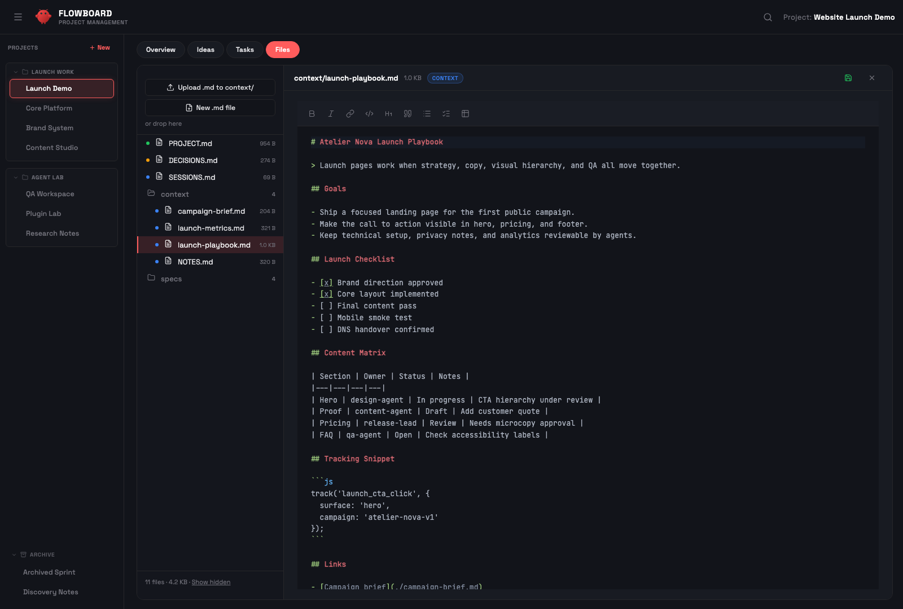

<h1 align="center">FlowBoard</h1>

<p align="center">
  <strong>Project workspaces for AI agents — inside <a href="https://github.com/openclaw/openclaw">OpenClaw</a>, or standalone for any coding agent.</strong>
</p>

<p align="center">
  <a href="https://github.com/rasimme/FlowBoard/blob/main/LICENSE"></a>
  <a href="https://github.com/rasimme/FlowBoard/releases"></a>
  <a href="https://github.com/rasimme/FlowBoard"></a>
</p>

<p align="center">
  <a href="#quick-start">Quick Start</a> •
  <a href="#inside-openclaw">Inside OpenClaw</a> •
  <a href="#features">Features</a> •
  <a href="#works-with-any-agent">Any agent</a> •
  <a href="docs/README.md">Docs</a> •
  <a href="CHANGELOG.md">Changelog</a>
</p>

---

Your agent starts every session blank. What was I building? What did we decide? What is next?

**FlowBoard gives each project a memory and a board that you and your agents share.**



- **Context that follows the project.** An agent working on a project gets its goal, decisions and rules — loaded on demand, so token use stays low.
- **A Kanban you both use.** Agents create tasks, write specs, claim work, checkpoint progress and hand over for review. You approve.
- **Ideas that become work.** Sketch on a canvas, then turn connected notes into tasks with specs.

Local-first: everything runs on your machine, event-sourced in SQLite. No SaaS, no account.

---

## How it works

1. **Create a project.** Tell your agent `FlowBoard: create project my-app`, or click **New** in the board.
2. **The agent works on tasks.** It claims a task, records checkpoints while it works, and completes it into review. Claiming a task also binds that session to the project, so there is nothing to activate first.
3. **You review.** Tasks waiting on you show up in one place. Approve, comment, or send them back.

---

## Inside OpenClaw

On OpenClaw 2026.9.2 or newer, FlowBoard is a page in the OpenClaw sidebar — the full dashboard, in OpenClaw's theme, with no second tab to keep open.

| | |
|---|---|
|  | **The whole dashboard, native.** Overview, Ideas, Tasks and Files, following your OpenClaw theme (light, dark or custom). |
|  | **"Needs me" widget.** Reviews waiting for you and blocked or stalled work, across all projects, on any session dashboard. |
|  | **Task panel.** The task a session is working on, next to the chat: activity, comments, approve. |

It also helps agents keep the board honest:

- **Checkpoint on commit.** A commit whose subject names a task the agent holds, such as `fix: retry upload (T-123)`, records a checkpoint on that task. On by default.
- **Reminder before finishing** (optional). An agent about to finish with a stale claim is asked once to checkpoint, complete or release it.

Neither changes the project context an agent receives, so the model's prompt cache is unaffected. Setup and details: [FlowBoard inside OpenClaw](docs/guide/openclaw-control-ui.md).

---

## Features

### 🧩 Project Overview

A widget dashboard per project that you and your agents can both arrange: what needs you, live activity and momentum, milestones, board preview, GitHub status, notes and links. 26 widgets, drag-and-drop editing, presets.



### 📋 Agent-native Kanban

Agents use the same REST API as the board. Tasks move `backlog → open → in-progress → review → done`.

- Parent tasks with subtasks and progress
- Specs with acceptance criteria, created together with the task
- Claims with leases, checkpoints, comments and a review gate
- Work states (`Working`, `Waiting`, `Blocked`, `Paused`) and stall detection
- A live view of which agent holds what



### 💡 Idea Canvas

Sticky notes and connections. **Create task** runs the Specify workflow: a few clarifying questions, then a proposal you review — a single task, a task with a spec, or a parent with subtasks.



### 📁 Files

Browse, preview and edit the project's knowledge: `PROJECT.md`, decisions, context files and specs, with a Markdown editor.



### 🤝 Works with any agent

OpenClaw agents get project context injected. External agents — Claude Code, Codex, Cursor, Aider, your own scripts — use the same REST API and the same task workflow, and appear on the same board. See [Works with any agent](#works-with-any-agent).

---

## Quick Start

```bash
openclaw plugins install flowboard   # the plugin: context hook, and the native page on newer hosts
node scripts/setup.mjs               # build the UI and run the dashboard as a per-user service
```

Open **http://localhost:18700**, click **Finish setup**, then tell your agent:

> FlowBoard: create project my-app

**Prerequisites:** Node.js ≥ 18. The plugin needs OpenClaw ≥ 2026.6.6; the dashboard also runs without OpenClaw.

To get the page inside OpenClaw, enable **Settings → Labs → Custom plugin UI** (OpenClaw ≥ 2026.9.2). Full steps: [FlowBoard inside OpenClaw](docs/guide/openclaw-control-ui.md#turn-it-on).

### What you get on which OpenClaw

| Your OpenClaw | What you get |
|---|---|
| **≥ 2026.9.2** | Everything: context hook, standalone dashboard, native page, widget, task panel, checkpoint hooks |
| **2026.6.6 – 2026.8.x** | Context hook and standalone dashboard |
| **None** | Standalone dashboard and the REST API for external agents |

One install works on all of them; FlowBoard uses what the host supports.

### What the install asks you to approve

On OpenClaw 2026.8 and newer, installing a plugin is a consent decision. FlowBoard asks for a hook on `agent:bootstrap`, a background service and, on ≥ 2026.9.2, a Control UI page and Gateway methods. The native page is not sandboxed; it runs with your Control UI authority. Read [SECURITY.md](SECURITY.md) before you accept.

More: [Install and consent in detail](docs/guide/install.md) · [Manual install](docs/guide/install.md#manual-install) · [Updating](docs/guide/how-to/update-flowboard.md)

---

## Commands

Say these in your live agent chat:

| Command | What it does |
|---|---|
| `FlowBoard: create project [name]` | Create a project |
| `FlowBoard: activate project [name]` | Pin this session to a project (for work without a task) |
| `FlowBoard: end project` | Release the pin |
| `FlowBoard: list projects` | List all projects |

Tasks, subtasks, specs and status changes the agent handles itself while working.

---

## Works with any agent

External agents talk to the same API. Install the trigger snippet once per repository:

```bash
node /path/to/FlowBoard/dashboard/install-trigger.mjs --repo ~/myrepo
```

It adds a short FlowBoard block to `AGENTS.md` (and links `CLAUDE.md` to it). The agent then registers itself, fetches project context on demand, and works tasks like any other agent. Pick a stable agent id per runtime, such as `claude-code`, `codex` or `cursor`.

More: [Use FlowBoard with external agents](docs/guide/how-to/external-agents.md)

---

## Remote access

FlowBoard is local by default. To reach the dashboard from your phone, put it behind a tunnel with authentication — for example as a Telegram Mini App.

More: [Remote access](docs/guide/how-to/remote-access.md) · [SECURITY.md](SECURITY.md)

---

## Architecture

- **Local-first.** Dashboard, API and data live on your machine.
- **Event-sourced.** Tasks, claims, checkpoints and comments are an append-only ledger in SQLite, built on [HZL](https://www.hzl-tasks.com).
- **One API.** The dashboard, OpenClaw agents and external agents use the same REST surface.
- **Lazy context.** Agents load rules and project knowledge when they need them.

More: [Concepts](docs/concepts/) · [Architecture decisions](docs/adr/) · [API reference](docs/reference/)

## Documentation

- [User guide](docs/guide/) — install, daily use, how-tos
- [Concepts](docs/concepts/) — how and why it works
- [Reference](docs/reference/) — API and environment variables

## Contributing

Contributions welcome — see [CONTRIBUTING.md](CONTRIBUTING.md).

## License

MIT © 2026

---

<p align="center">
  <strong>Built with ❤️ for the <a href="https://github.com/openclaw/openclaw">OpenClaw</a> community</strong>
</p>
